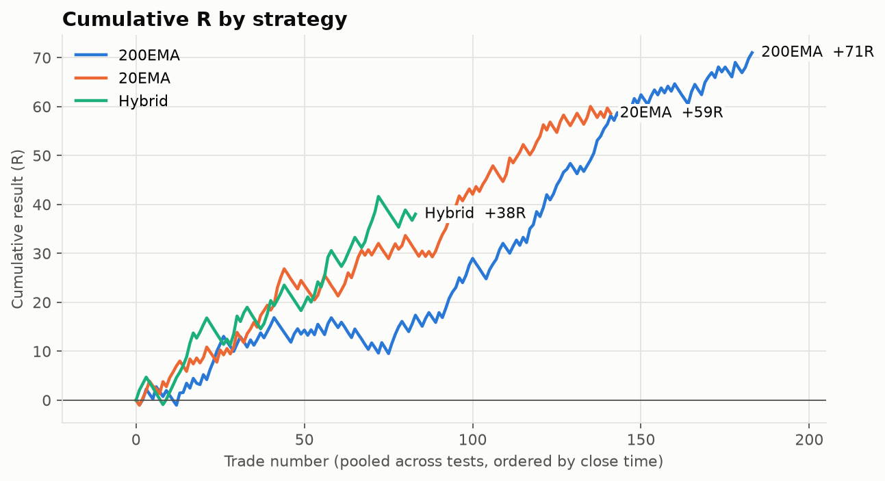
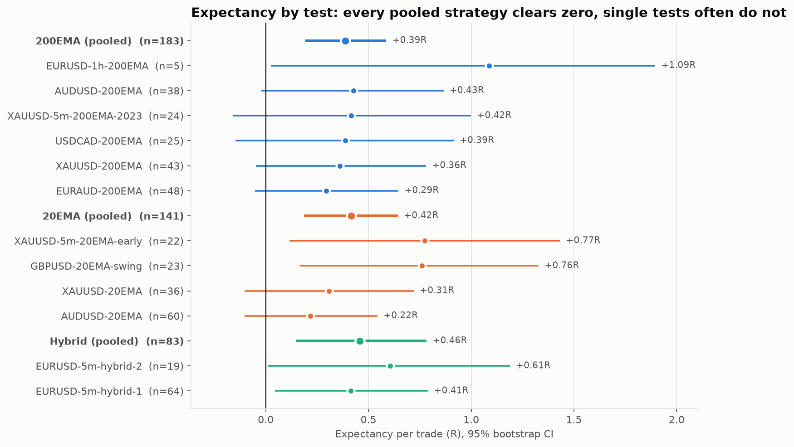
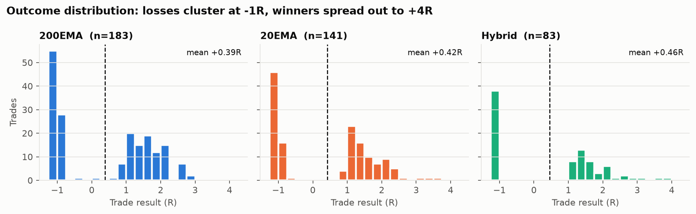
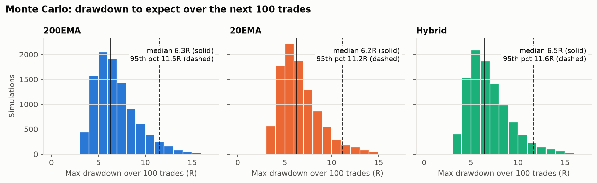

# EMA Strategy Validation

**A statistical review of 407 backtested trades from two EMA trend-pullback strategies (FX & gold, 2023–2025)**

[](https://github.com/Yugo25/ema-strategy-validation/actions/workflows/ci.yml)


[日本語版 README はこちら](README.ja.md)

I designed two discretionary forex/gold strategies built on the 20- and 200-period EMAs and
backtested them by hand in Forex Tester: 12 tests, 6 instruments, 2023–2025. This repository
re-analyses every trade independently in Python. It asks whether the edge is real, how
large it is after costs, and what drawdowns to expect.

**Summary**

- **407 trades, net expectancy +0.41R per trade** (95% bootstrap CI +0.28R to +0.55R) after
  commission. In the bootstrap, fewer than 0.1% of resamples show a zero or negative edge.
  That figure assumes the backtest itself is unbiased; see [Limitations](#limitations).
- **Both strategies show an edge on their own** (200EMA +0.39R, 20EMA +0.42R), but **neither
  beats the other** (permutation test p = 0.86). Choosing between them is a matter of
  fit and frequency, not edge.
- At 1% risk per trade, simulations of the next 100 trades suggest a typical **max drawdown
  of ~6R** (95th percentile ~11R) and **losing streaks of up to 8**.
- The profile is a **trend-following payoff**: win rate ~55%, average win ~1.6× average loss
  (breakeven win rate 39%). No loss exceeds −1R: 183 of 185 losing trades are clean
  stop-outs, and the other 2 were cut early.



---

## The strategies

Both strategies trade **with** a trend confirmed on two higher timeframes. Both enter on a
pullback and only once the price structure confirms that the pullback is over.

| | [200EMA strategy](docs/strategy-200ema.md) | [20EMA strategy](docs/strategy-20ema.md) |
|---|---|---|
| Market idea | Trend continuation after a deep pullback | The first leg after an old trend's structure breaks (wave 3) |
| Filter | Higher-TF 200EMA slopes in trade direction | Same |
| Setup | EMA cross → price pulls back to the **200EMA** | Old structure broken by a first wave → pullback to the **20EMA** |
| Trigger | Candle body closes through the pullback's trendline (only if drawn through real reacting swings) | Candle body closes beyond the 20EMA-touch candle |
| Target | Measured move of the prior impulse | Unreached swing left by the broken trend |
| Execution | 5m (also 1h) | 5m (also 1h) |

**Hybrid** tests traded both setups side by side on EURUSD.

The strategy pages describe the rules at concept level. The scoring rubric I use to grade
each setup is kept private.

## Results

All figures are in **R** (multiples of the risk taken on each trade), **net of commission**.
See [methodology](docs/methodology.md) for definitions.

### By strategy

| Strategy | Trades | Win rate | Avg win / avg loss | E[R] net | 95% CI | P(E≤0) | Max DD (R) |
|---|---:|---:|---:|---:|---:|---:|---:|
| 200EMA | 183 | 54.1% | 1.55 | **+0.39** | +0.19 to +0.59 | <0.001 | 7.3 |
| 20EMA | 141 | 55.3% | 1.53 | **+0.42** | +0.19 to +0.64 | <0.001 | 6.4 |
| Hybrid | 83 | 54.2% | 1.63 | **+0.46** | +0.15 to +0.78 | 0.002 | 6.3 |
| **All** | **407** | **54.5%** | **1.56** | **+0.41** | **+0.28 to +0.55** | **<0.001** | 6.2 |

### By test



Full per-test table (trades, win rate, profit factor, gross vs net expectancy, drawdown in R
and %, holding time): **[reports/summary.md](reports/summary.md)**.

### What a trade looks like



### What to expect going forward



## Findings

1. **The pooled edge is statistically clear; single tests are not.** Only 5 of 12 tests have a
   CI that excludes zero on their own, and most tests have 20–60 trades. That sample size
   is too small to judge a 55%-win-rate strategy. Pooling in R units is what makes the
   conclusion possible.
2. **Early results were too good.** The first, smallest tests showed +0.76R to +1.09R per
   trade. The larger later tests (36+ trades) settled at +0.2R to +0.45R. I treat the latter
   as the realistic estimate.
3. **Costs matter on 5m FX.** Commission removes 0.08–0.10R per trade on the 5m FX tests,
   15–30% of their gross edge (e.g. AUDUSD-20EMA: +0.32R gross → +0.22R net). Gold, with
   ~zero commission, keeps its gross edge.
4. **The 20EMA strategy works much better long than short.** 20EMA longs: +0.65R (CI +0.35
   to +0.95). 20EMA shorts: +0.13R, a CI that includes zero. Longs beat shorts on all three
   instruments it was tested on (AUDUSD, GBPUSD, XAUUSD). The 200EMA strategy is positive on
   both sides. Whether 20EMA shorts need a stricter filter is the first question for forward
   testing.
5. **Reviewing losses led to rule changes.** My trade review found 200EMA losses concentrated in
   periods when I traded crosses in flat, ranging markets. In the data, the 200EMA tests' only
   losing quarter is 2024 Q2 (−2.7R over 18 trades). This produced the higher-timeframe slope
   filter. See the [research log](docs/research-log.md).

## Limitations

These are manual, discretionary backtests, not live trading. The main caveats:

- **Hindsight and judgement bias.** Knowing the broad market history can leak into decisions.
- **Not out-of-sample.** The rules evolved while these tests were run.
- **No slippage modelled.** Commission and spread are included, slippage is not.
- **Resampling assumes independent trades.** Regimes violate that, so tail drawdowns are likely understated.

Details: [methodology § Limitations](docs/methodology.md#6-limitations).

## Roadmap

1. **Systematic baselines.** Is the edge better than random entries with the same exits? Does the
   higher-timeframe slope filter add value on its own? How much does discretionary selection add
   over a mechanical version? See the [design](docs/roadmap.md).
2. **Forward test.** Run the frozen rules on a demo account and analyse them with this pipeline
   as a true out-of-sample set.

## Reproduce

```bash
make setup     # creates .venv and installs pinned dependencies
make lint      # ruff lint + format check
make test      # 24 tests, incl. checking the parser against Forex Tester's own reports
make report    # rebuilds reports/summary.md, reports/tables/*.csv, reports/figures/*.png
```

The build is deterministic (fixed seeds). CI fails if the committed report differs from a fresh build.

## Repository layout

```
data/
  raw/trades/                 Forex Tester trade exports (unmodified)
  raw/forextester_reports/    Forex Tester analytics reports (used only for cross-checks)
  manifest.csv                test → strategy, instrument, timeframe, research date
docs/                         strategy notes, methodology, research log (docs/ja: Japanese originals)
src/emaresearch/
  load.py                     parsing, cleaning, R and net-R calculation
  metrics.py                  expectancy, payoff, profit factor, drawdown, streaks
  stats.py                    bootstrap CI, permutation test, Monte Carlo
  plots.py                    figures
scripts/build_report.py       end-to-end report build
tests/                        unit tests + reconciliation against Forex Tester
reports/                      generated output (summary, tables, figures)
```

## Skills demonstrated

- **Strategy design.** Rule-based discretionary systems with explicit entry, exit and skip
  conditions, revised from evidence.
- **Quantitative evaluation.** R-multiple normalisation, cost-adjusted expectancy, bootstrap
  confidence intervals, permutation tests, Monte Carlo risk estimates.
- **Research hygiene.** Raw data kept immutable, independent recomputation reconciled
  against the vendor's numbers, documented data issues, honest limitations.
- **Engineering.** A tested Python package, a reproducible build, linting and CI.

## About

**Yugo Kawamura** — based in Canada. I design and test trading strategies, and I care
most about measuring them honestly.
[LinkedIn](https://www.linkedin.com/in/YOUR-LINKEDIN-ID) · [GitHub](https://github.com/Yugo25)

---

*Not investment advice. Backtested results do not guarantee future performance.*
